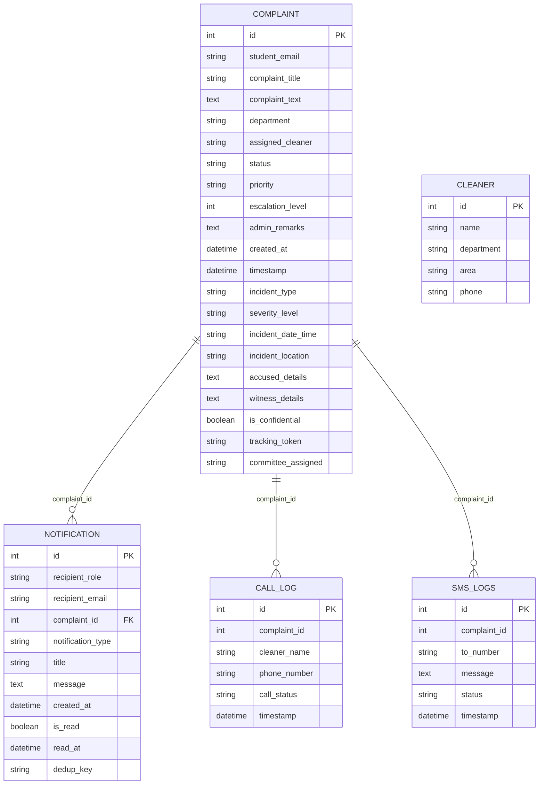

# ANTI-RAGGING PORTAL — COMPREHENSIVE PROJECT ANALYSIS AND TECHNICAL AUDIT REPORT

**Institution:** Vel Tech High Tech Dr. Rangarajan Dr. Sakunthala Engineering College  
**System Name:** Institutional Anti-Ragging Redressal & Incident Monitoring Portal  
**Project Path:** `C:\PROJECTS\ANTI_RAGGING_PORTAL`  
**Report Date:** 2026-10-13  
**Auditor:** Senior Full-Stack Software Engineer  
**Objective:** Complete technical inspection and architectural baseline report for upcoming implementation phases (P1 through P6).

---

## 1. Project Overview

The Anti-Ragging Portal is a dedicated, institutional web application developed for Vel Tech High Tech Dr. Rangarajan Dr. Sakunthala Engineering College to satisfy statutory regulatory compliance (UGC Anti-Ragging Regulations & AICTE norms) and support confidential student grievance reporting. 

The application establishes a two-portal architecture:
1. **Student Incident Redressal Portal:** Passwordless, OTP-verified student access for confidential incident reporting, severity suggestion, tracking reference generation, and persistent status notifications.
2. **Anti-Ragging Committee (ARC) Administrative Console:** Role-authenticated administrative console featuring real-time grievance review, statutory incident categorization, analytical charts, status updates with email dispatches, a persistent notification engine, and an automated pending-action queue.

---

## 2. Technology Stack and Versions

| Component | Technology | Version | Notes / Purpose |
|---|---|---|---|
| **Programming Language** | Python | `3.14.2` | Core backend runtime |
| **Backend Web Framework** | Flask | `3.1.2` | Lightweight WSGI web framework |
| **Database ORM** | Flask-SQLAlchemy / SQLAlchemy | `3.1.1` (SQLAlchemy `2.0+` compatibility layer) | Database ORM and schema migration |
| **Session Management** | Flask-Session | `0.8.0` | Server-side filesystem sessions |
| **Database Engine** | SQLite3 | Native / Python standard library | File-based development databases (`anti_ragging_dev.db`) |
| **Machine Learning / Triage** | scikit-learn | `1.8.0` | Incident classification & severity triage models |
| **Array & Data Processing** | numpy (`2.3.5`), pandas (`2.3.3`), scipy (`1.16.3`) | Production versions | Data manipulation and vectorizer support |
| **Model Persistence** | joblib (`1.5.3`), pickle | Python built-in & wheel | Model serialization (`complaints_model.pkl`, `vectorizer.pkl`) |
| **Email Protocol** | smtplib, email.mime | Python standard library | Multi-part HTML/plaintext OTP and status notifications |
| **SMS / Voice Integration** | Twilio Python SDK | `9.10.2` | Simulated/Production emergency call & SMS logging |
| **Frontend Architecture** | Jinja2 Server-Side Templates | Bundled with Flask | 12 active HTML templates |
| **Styling** | Vanilla CSS3 (Custom Institutional Design System) | Native | Modular CSS with CSS custom properties |
| **Client-Side Scripting** | Vanilla JavaScript (ES6+) | Native | Dropdown management, modal dialogs, CSRF-authenticated AJAX fetch |
| **Data Visualization** | Chart.js | `3.x+` (via jsDelivr CDN) | Admin category distribution & status charts |
| **Testing Framework** | unittest (Python Standard Library) | `3.14.2` | Isolated in-memory database test suite |
| **Environment Configuration** | python-dotenv | `1.2.1` | Local `.env` loading |
| **Production WSGI** | gunicorn | `23.0.0` | Production application server |

---

## 3. Project Folder Structure

```
C:\PROJECTS\ANTI_RAGGING_PORTAL
│
├── .env                                    # Environment configuration (secrets redacted)
├── .gitignore                              # Git exclusion patterns
├── README.md                               # Project documentation
├── requirements.txt                        # Python dependencies
│
├── grievai_app.py                          # Core Flask application (Models, Routes, Controller, Services)
│
├── anti_ragging_dev.db                     # Development SQLite database (4 protected development records)
├── anti_ragging_browser_test.db            # Browser automated testing SQLite database
├── complaints.db                           # Legacy database file
├── complaints_backup_v1.db                 # Historical schema backup
├── complaints.sqbpro                       # SQLite database project config
│
├── campus_model.pkl                        # Pre-trained campus ML model
├── campus_vectorizer.pkl                   # Campus text TF-IDF vectorizer
├── complaints_model.pkl                    # Pre-trained incident classification model
├── vectorizer.pkl                          # Incident TF-IDF text vectorizer
├── label_encoder.pkl                       # Scikit-learn target label encoder
├── hostel_model.pkl                        # Pre-trained hostel ML model
├── hostel_vectorizer.pkl                   # Hostel text vectorizer
│
├── college_campus_complaints.csv           # Historical campus complaint dataset
├── hostel_complaints.csv                   # Historical hostel complaint dataset
├── student_complaints.csv                  # Baseline complaint training corpus
│
├── train_model.py                          # ML model training script
├── train_campus_model.py                   # Campus ML training script
├── train_hostel_model.py                   # Hostel ML training script
├── add_cleaners.py                         # Committee/support desk seed script
│
├── flask_session\                          # Server-side filesystem session storage
│
├── static\                                 # Static assets
│   ├── css\
│   │   ├── style.css                       # Primary institutional stylesheet & design tokens
│   │   ├── auth.css                        # Authentication layouts
│   │   ├── student_login.css               # Student login styling
│   │   ├── verify_otp.css                  # OTP countdown & form styling
│   │   ├── dashboard.css                   # Student dashboard layout
│   │   ├── student_dashboard.css           # Student grievance table styles
│   │   ├── complaint_form.css              # Multi-field incident reporting styles
│   │   ├── landing.css                     # Landing page hero & grid styles
│   │   ├── index.css                       # Index entry styles
│   │   ├── track.css                       # Tracking timeline and status cards
│   │   ├── admin.css                       # ARC Review Console & analytics styles
│   │   ├── admin_login.css                 # Admin credential entry styles
│   │   └── error.css                       # Security and error screen styles
│   │
│   ├── images\
│   │   ├── veltech_college_logo.png        # Official institutional logo asset (362 KB)
│   │   └── logo.png                        # Secondary emblem asset (259 KB)
│   │
│   └── js\
│       ├── admin.js                        # Admin complaint details modal & chart rendering
│       └── dashboard.js                    # Student dashboard interactions
│
├── templates\                              # Jinja2 template views (12 active templates)
│   ├── index.html                          # Landing page
│   ├── student_login.html                  # Student email entry view
│   ├── verify_otp.html                     # OTP code verification view
│   ├── student_dashboard.html              # Student dashboard & grievance history
│   ├── complaint_form.html                 # Incident reporting form
│   ├── success.html                        # Submission receipt & tracking token presentation
│   ├── track.html                          # Tracking status lookup & progress stepper
│   ├── admin_login.html                    # Administrator credential login
│   ├── admin.html                          # ARC Committee dashboard & pending queue
│   ├── admin_complaint_detail.html         # Individual incident review & status update form
│   ├── admin_logs.html                     # Communications & notification dispatch logs
│   └── error.html                          # Generic error and security exception screen
│
└── tests\                                  # Automated test suite
    ├── __init__.py                         # Test package marker
    ├── test_security_hardening.py          # Security, authentication & CSRF tests (27 tests)
    ├── test_e2e_workflows.py               # Student/Admin workflow integration tests (12 tests)
    └── test_notifications.py               # Two-way notification & reminder engine tests (12 tests)
```

---

## 4. Instructions for Running the Project Locally

### Prerequisites
- Python `3.10+` (Installed: Python `3.14.2`)
- SQLite3 runtime

### Step 1: Environment Variables Setup
Ensure `.env` in `C:\PROJECTS\ANTI_RAGGING_PORTAL` contains valid keys:
```ini
# Core Configuration
SECRET_KEY=[REDACTED]
DATABASE_URL=sqlite:///anti_ragging_dev.db
FLASK_ENV=development

# Administrator Credentials
ADMIN_EMAIL=[REDACTED_ADMIN_EMAIL]
ADMIN_PASSWORD=[REDACTED_ADMIN_PASSWORD]

# Email Notification Delivery (Gmail SMTP)
SMTP_EMAIL=[REDACTED_SMTP_EMAIL]
SMTP_PASSWORD=[REDACTED_SMTP_APP_PASSWORD]

# Simulated Email Mode (Optional for local testing without network)
DEV_SIMULATE_EMAIL=False

# Review Window Thresholds (Configurable hours)
REMINDER_OPEN_HOURS=24
REMINDER_IN_PROGRESS_HOURS=72
REMINDER_CHECK_INTERVAL_SECONDS=3600
```

### Step 2: Running the Development Server
From PowerShell or Command Prompt:
```powershell
cd C:\PROJECTS\ANTI_RAGGING_PORTAL
python grievai_app.py
```
- **Local Port:** `http://127.0.0.1:5000`
- **Startup Sequence:** Automatically initializes database schema via `db.create_all()`, runs runtime column migration, and starts the `ARC-Reminder-Scheduler` background daemon.

### Step 3: Running Automated Tests
The test suite operates entirely in-memory (`sqlite:///:memory:`) without modifying `anti_ragging_dev.db`:
```powershell
cd C:\PROJECTS\ANTI_RAGGING_PORTAL
python -m unittest discover -s tests -v
```
**Current Test Status:** **51 tests passed, 0 failures, 0 errors.**

---

## 5. Complete Page and Route Inventory

The application exposes **24 HTTP routes** corresponding to **12 active templates** and **7 JSON API endpoints**:

| # | Route / Endpoint | HTTP Method | Associated Template / Response | Role / Access Control | Header & Logo Present | Footer Present | Status |
|---|---|---|---|---|---|---|---|
| 1 | `/` | `GET` | `templates/index.html` | Public | Yes (`veltech_college_logo.png`) | Yes (Inconsistent) | `Existing` |
| 2 | `/student_login` | `GET` | `templates/student_login.html` | Public / Student | Yes (Center Card) | **No** (Missing) | `Existing` |
| 3 | `/send_otp` | `POST` | Redirects to `/verify_otp` or `error.html` | Public / Student + CSRF | N/A (Redirect) | N/A | `Existing` |
| 4 | `/verify_otp` | `GET` | `templates/verify_otp.html` | Pending Student Session | Yes (Center Card) | **No** (Missing) | `Existing` |
| 5 | `/verify_otp` | `POST` | Redirects to `/student_dashboard` | Pending Student Session + CSRF | N/A (Redirect) | N/A | `Existing` |
| 6 | `/resend_otp` | `POST` | Redirects to `/verify_otp` | Pending Student Session + CSRF | N/A (Redirect) | N/A | `Existing` |
| 7 | `/student_dashboard` | `GET` | `templates/student_dashboard.html` | Verified Student Session | Yes (Navbar) | Yes (Inconsistent) | `Existing` |
| 8 | `/student_logout` | `GET` | Redirects to `/` | Verified Student Session | N/A (Redirect) | N/A | `Existing` |
| 9 | `/complaint_form` | `GET` | `templates/complaint_form.html` | Verified Student Session | Yes (Navbar) | Yes (Inconsistent) | `Existing` |
| 10 | `/predict` | `POST` | `templates/success.html` | Verified Student Session + CSRF | Yes (Navbar) | Yes (Inconsistent) | `Existing` |
| 11 | `/admin_login` | `GET`, `POST` | `templates/admin_login.html` | Public / Administrator + CSRF | Yes (Center Card) | **No** (Missing) | `Existing` |
| 12 | `/admin` | `GET`, `POST` | `templates/admin.html` | Authenticated Administrator + CSRF | Yes (Dark Navbar) | Yes (Inconsistent) | `Existing` |
| 13 | `/admin/complaint/<id>` | `GET`, `POST` | `templates/admin_complaint_detail.html` (or JSON) | Authenticated Administrator + CSRF | Yes (Dark Navbar) | Yes (Inconsistent) | `Existing` |
| 14 | `/admin/logs` | `GET` | `templates/admin_logs.html` | Authenticated Administrator | Yes (Dark Navbar) | Yes (Inconsistent) | `Existing` |
| 15 | `/update_call_status` | `POST` | Redirects to `/admin/logs` | Authenticated Administrator + CSRF | N/A (Redirect) | N/A | `Existing` |
| 16 | `/admin_logout` | `GET` | Redirects to `/` | Authenticated Administrator | N/A (Redirect) | N/A | `Existing` |
| 17 | `/track` | `GET`, `POST` | `templates/track.html` | Public / Token Owner + CSRF | Yes (Navbar) | Yes (Inconsistent) | `Existing` |
| 18 | `/student/notifications` | `GET` | JSON (`{notifications: [], unread_count}`) | Verified Student Session | N/A (API) | N/A | `Existing` |
| 19 | `/student/notifications/<id>/read` | `POST` | JSON (`{success: true}`) | Verified Student Session + CSRF | N/A (API) | N/A | `Existing` |
| 20 | `/student/notifications/mark_all_read` | `POST` | JSON (`{success: true}`) | Verified Student Session + CSRF | N/A (API) | N/A | `Existing` |
| 21 | `/admin/notifications` | `GET` | JSON (`{notifications: [], unread_count}`) | Authenticated Administrator | N/A (API) | N/A | `Existing` |
| 22 | `/admin/notifications/<id>/read` | `POST` | JSON (`{success: true}`) | Authenticated Administrator + CSRF | N/A (API) | N/A | `Existing` |
| 23 | `/admin/notifications/mark_all_read` | `POST` | JSON (`{success: true}`) | Authenticated Administrator + CSRF | N/A (API) | N/A | `Existing` |
| 24 | `/admin/pending_queue` | `GET` | JSON (`{queue: [], thresholds: {}}`) | Authenticated Administrator | N/A (API) | N/A | `Existing` |

---

## 6. Authentication and Role Permissions

### Architecture
Authentication is strictly partitioned into two independent mechanisms:
1. **Student Authentication (`session['verified'] = True`, `session['email'] = str`):**
   - Implemented via a passwordless One-Time Password (OTP) workflow.
   - Entry point: `GET /student_login` -> `POST /send_otp` -> `POST /verify_otp`.
   - The OTP is a 6-digit numeric string generated via `secrets.randbelow(900000) + 100000` (CSPRNG).
   - Enforces a 60-second expiration window (`time.time() - session['otp_time'] > 60`).
   - Single-use invalidation: Upon verification, OTP is deleted from the session.
   - Throttling: 30-second cooldown between resends, maximum 5 attempts.
2. **Administrator Authentication (`session['admin_logged_in'] = True`):**
   - Implemented via constant-time password comparison (`secrets.compare_digest`).
   - Credentials configured via environment variables `ADMIN_EMAIL` and `ADMIN_PASSWORD`.
   - Entry point: `GET /admin_login` -> `POST /admin_login`.
   - Brute-force protection: Locks out client IP after 5 failed attempts for 10 minutes (`check_admin_rate_limit(client_ip)`).
3. **Session Role Isolation:**
   - When a student authenticates, `session.pop("admin_logged_in", None)` is executed.
   - When an administrator authenticates, `session.pop("verified", None)` and `session.pop("email", None)` are executed.
   - Cross-role privilege escalation is strictly blocked.

### Findings on Student Registration
- **Registration Form:** `Missing` (Not present).
- Any student with an authorized email address can authenticate directly through OTP. No pre-registration or password setup is required.

---

## 7. Database Models and Relationships

The database is managed via SQLAlchemy within `grievai_app.py`. All tables are mapped in `anti_ragging_dev.db`:



### Table Details:
1. **`complaint` (`Complaint`):** Stores grievance records. Contains both legacy fields (`department`, `assigned_cleaner`) and modern anti-ragging attributes (`incident_type`, `severity_level`, `is_confidential`, `tracking_token`, `committee_assigned`).
2. **`notification` (`Notification`):** Stores persistent two-way notifications for students and administrators with unique `dedup_key` for idempotent scheduling.
3. **`cleaner` (`Cleaner`):** Legacy facility staff seed table.
4. **`call_log` (`CallLog`):** Telephony logs for simulated or live committee calls.
5. **`sms_logs` (`SMSLog`):** SMS dispatch history.

### Database Constraints and Migration Strategy:
- Database path: `anti_ragging_dev.db`.
- Safe startup schema check: Uses `db.create_all()` plus runtime `ALTER TABLE` inspections to ensure new columns are added without dropping or corrupting existing tables.
- **Record Preservation:** Development database currently holds **4 active records** which must remain untouched.

---

## 8. Complaint Workflow and Lifecycle

### Step 1: Submission (`POST /predict`)
1. Student enters description, category, incident datetime, location, accused details, witness details, confidentiality preference, and signs truthfulness declaration on `templates/complaint_form.html`.
2. Controller `predict()` in `grievai_app.py` (lines 1179–1290) validates required fields.
3. Machine learning models (`determine_incident_category` and `suggest_provisional_severity`) suggest provisional categorization and severity (`Low`, `Medium`, `High`, `Critical`).
4. Generates a random cryptographic tracking token: `ARC-{secrets.token_urlsafe(16)}`.
5. Computes SHA-256 hash `stored_token_hash = hash_tracking_token(raw_token)` to store in `complaint.tracking_token`.
6. Saves complaint with initial status `"Open"`.
7. Dispatches persistent admin alert via `create_notification(recipient_role="admin", ...)`.
8. Renders `templates/success.html` displaying reference `#ID` and raw one-time tracking token.

### Step 2: Administrative Review (`GET /admin`, `GET /admin/complaint/<id>`)
1. Administrator views list of all grievances sorted by `timestamp.desc()`.
2. Overview statistics display live counts for `Open`, `Under Review`, `Action Taken`, and `Closed`.
3. Committee Pending-Action Queue highlights unattended complaints exceeding review thresholds (`Open > 24h`, `Under Review > 72h`).

### Step 3: Status Updates (`POST /admin`, `POST /admin/complaint/<id>`)
1. Administrator selects new status (`Open`, `Under Review`, `Action Taken`, `Closed`) and enters administrative remarks.
2. Legacy synonyms are automatically normalized:
   - `In Progress`, `In-Progress`, `Assigned` -> `Under Review`
   - `Resolved` -> `Closed`
3. Controller updates `complaint.status`, `complaint.admin_remarks`, and `complaint.timestamp = datetime.utcnow()`.
4. Executes `db.session.commit()`.
5. **Persistent Notification:** Automatically creates an in-app student notification: `create_notification(recipient_role="student", recipient_email=student_email, ...)`.
6. **Email Dispatch:** Calls `send_status_update_email(...)` wrapped in an isolated `try...except` block so network/SMTP failures never roll back database updates.

### Step 4: Tracking (`GET, POST /track`)
1. Student accesses `templates/track.html`.
2. **Dual-Authorization Verification:**
   - **Mode A (Authenticated Student):** Access granted if `complaint.student_email == session['email']`.
   - **Mode B (Public / Confidential Access):** Requires Complaint `#ID` AND raw tracking token matching constant-time hash verification.
3. Displays confidential resolution stepper: `Registered (Open)` -> `Under Review` -> `Action Taken` -> `Closed`.

---

## 9. Student Email Restrictions Analysis

### Current Implementation
- **File:** `grievai_app.py`
- **Function:** `send_otp()` (lines 1000–1040)
- **Current Validation Logic:**
  ```python
  raw_email = request.form.get("email", "")
  email = raw_email.strip().lower()

  if not email or "@" not in email or not email.endswith("@velhightech.com"):
      return render_template("error.html", ...)
  ```
- **Evaluation:** `Partially Implemented`. The system checks that the email ends with `@velhightech.com`, but accepts *any* prefix (e.g. `staff@velhightech.com`, `admin@velhightech.com`, `xyz@velhightech.com`).

### Target College Requirement
- **Student Email Format:** `vh[0-9]+@velhightech.com` (e.g. `vh13838@velhightech.com`).
- **Required Regular Expression:** `^vh[0-9]+@velhightech\.com$`

### Separation & Safe Enforcement Strategy (Priority P2)
- Student OTP login (`/student_login` -> `/send_otp`) is **completely isolated** from administrator login (`/admin_login`).
- Updating `send_otp()` to enforce `re.match(r"^vh[0-9]+@velhightech\.com$", email)` will **only** restrict student logins and will **never** block administrator or committee access.
- Administrator login authenticates through `/admin_login` using `ADMIN_EMAIL` and `ADMIN_PASSWORD` without invoking `send_otp()`.

---

## 10. Evidence Upload Capabilities (Photo, Audio, Video)

### Current Audit Findings
- **File Upload Capability:** `Missing`.
- **`request.files` in `grievai_app.py`:** None.
- **`enctype="multipart/form-data"` in `complaint_form.html`:** None (`<form method="POST" action="/predict" id="complaint-form" novalidate>`).
- **Database Support for Evidence:** None. Table `complaint` has no attachment columns, and no `Attachment` or `Evidence` model exists.
- **Storage Directory:** No upload directory configured.
- **Audio Recording Capabilities:** None. No client-side `MediaRecorder` or microphone interaction script exists.

### Architecture Plan for Priority P3
1. **Database Schema:** Create a dedicated `ComplaintEvidence` model:
   ```python
   class ComplaintEvidence(db.Model):
       __tablename__ = "complaint_evidence"
       id = db.Column(db.Integer, primary_key=True)
       complaint_id = db.Column(db.Integer, db.ForeignKey("complaint.id"), nullable=False, index=True)
       file_type = db.Column(db.String(20), nullable=False) # 'image', 'audio', 'video', 'document'
       original_filename = db.Column(db.String(255), nullable=False)
       storage_filename = db.Column(db.String(255), nullable=False, unique=True)
       mime_type = db.Column(db.String(100), nullable=False)
       file_size_bytes = db.Column(db.Integer, nullable=False)
       uploaded_at = db.Column(db.DateTime, default=datetime.utcnow, nullable=False)
   ```
2. **Storage Location:** Store outside public web root: `C:\PROJECTS\ANTI_RAGGING_PORTAL\uploads\evidence\` (never inside `static/`).
3. **Audio Capture:** In `templates/complaint_form.html`, embed an accessible microphone audio recorder utilizing the browser's `navigator.mediaDevices.getUserMedia({ audio: true })` and `MediaRecorder` API, generating `audio/webm` or `audio/ogg` blobs appended to the form submission.
4. **Security Controls:**
   - Enforce `app.config['MAX_CONTENT_LENGTH'] = 25 * 1024 * 1024` (25MB aggregate cap).
   - Server-side MIME validation: Validate file extensions AND inspect magic bytes (`open(..., 'rb').read(32)` byte signatures). Allowed: `.jpg`, `.jpeg`, `.png`, `.webp`, `.mp3`, `.wav`, `.ogg`, `.webm`, `.mp4`, `.pdf`.
   - Randomized storage filenames: `uuid4().hex + ext` to eliminate path traversal and collisions.
   - Access-Controlled File Serving: Download route `GET /admin/evidence/<evidence_id>` strictly checking `session['admin_logged_in']` or authenticated complaint ownership via `send_from_directory`.

---

## 11. College Logo, Header and Footer Implementation

### Current Audit Findings
- **Logo Asset:**
  - File: `static/images/veltech_college_logo.png` (362,611 bytes).
  - Alternate: `static/images/logo.png` (259,601 bytes).
- **Logo Appearance:** Present across all 12 active templates:
  ``
- **Logo Styling (`static/css/style.css`):**
  - Uses `.college-logo-container` with background `#000000`, border radius, and `.college-logo { width: 100%; height: 100%; object-fit: contain; }`.
  - Proportions are locked to prevent distortion.
- **Header & Layout Architecture:**
  - `Missing`: No shared Jinja2 base layout (`base.html` or `layout.html`) exists.
  - Every template defines its own `<header>` and navbar independently.
- **Footer Implementation:**
  - 4 templates (`student_login.html`, `verify_otp.html`, `admin_login.html`, `error.html`) have **no footer**.
  - 8 templates have inconsistent footers with encoding artifacts (` 2026`).
  - **Proposed Standard Institutional Footer:**
    ```html
    <footer class="portal-footer">
        <div class="footer-compliance">NBA – Tier 1 SAR Guideline: Criterion No. 10.1.4</div>
        <div class="footer-copyright">Powered by Anti-Ragging Committee | &copy; 2026 Vel Tech High Tech Dr. Rangarajan Dr. Sakunthala Engineering College. All rights reserved.</div>
    </footer>
    ```

---

## 12. Admin Notifications for Untouched Complaints

### Current Audit Findings
- **Status:** `Existing`.
- **Model:** `Notification` in `grievai_app.py` with `recipient_role="admin"` and `notification_type="pending_reminder"`.
- **Untouched Incident Detection:**
  - Configured review thresholds: `REMINDER_OPEN_HOURS = 24` and `REMINDER_IN_PROGRESS_HOURS = 72`.
  - Excludes `Closed` and `Resolved` cases.
  - Evaluates elapsed hours: `(now - complaint.timestamp).total_seconds() / 3600.0`.
- **Idempotent Deduplication:**
  - Generates deterministic keys: `reminder:open:<id>:<bucket>h` (e.g. `reminder:open:3:24h`, `reminder:open:3:48h`).
  - Pre-query check prevents duplicate reminders for the same incident within the same interval window.
- **Scheduler:**
  - Non-blocking daemon thread `ARC-Reminder-Scheduler` running every `REMINDER_CHECK_INTERVAL_SECONDS` (3600s).
  - Deterministic callable `process_pending_action_reminders(now=None)` and queue generator `get_admin_pending_action_queue(now=None)`.
- **UI Presentation:**
  - Active bell badge on ARC navbar (`templates/admin.html`).
  - Dedicated **"Committee Pending-Action Queue"** card showing overdue incidents, elapsed hours, urgency levels (`HIGH` / `MEDIUM`), and direct review links.

---

## 13. Professional UI and Emoji Audit

### Emoji Audit Results
- **Full Codebase Audit:** Scanned all `.html`, `.css`, `.js`, and `.py` files using unicode ranges `[\U00010000-\U0010ffff]|[\u2600-\u27bf]`.
- **Result:** **0 emojis found across all active application templates and source files.** All icons have been replaced with accessible inline SVG icons (`.svg-icon`).

### UI Consistency & Styling Observations
1. **Design System:** Built upon a cohesive institutional navy/slate palette:
   - Primary Institutional Navy: `#1e3a8a`
   - Action / Focus Blue: `#3b82f6`
   - Dark Navy Navbar: `#172554`
   - Background Slate: `#f8fafc`
   - Borders: `#e2e8f0`
   - Text Colors: `#0f172a` (Headings), `#334155` (Body), `#64748b` (Muted)
2. **Typography:** Standardizes on clean system font stacks (`Segoe UI`, `-apple-system`, `Roboto`, `sans-serif`).
3. **Accessibility:** Form fields contain `<label>` elements, `:focus-visible` states, and `aria-label` attributes on notification bells and SVG buttons.
4. **Mobile Responsiveness:** Viewports down to 320px are supported with media queries in `static/css/style.css`.

---

## 14. Security and Privacy Audit Findings

| Category | Finding | Severity | File / Function | Description & Recommendation |
|---|---|---|---|---|
| **Authentication** | Student Email Domain Pattern | **Medium** | `grievai_app.py` -> `send_otp()` | Currently only checks `endswith("@velhightech.com")`. Non-student college emails can enter student workflow. Enforce regex `^vh[0-9]+@velhightech\.com$`. |
| **Authentication** | Plaintext Environment Admin Password | **Low / Informational** | `grievai_app.py` -> `admin_login()` | Password checked via constant-time `secrets.compare_digest(password, ADMIN_PASSWORD)` against `.env`. Safe for prototype; recommend bcrypt hashed storage in production. |
| **CSRF** | Custom CSRF Implementation | **Low** | `grievai_app.py` -> `validate_csrf()` | Custom before-request validator supports form field, headers, and JSON body with constant-time comparison. Tested and passing across all POST routes. |
| **Data Isolation** | Multi-Student Ownership | **Verified Safe** | `grievai_app.py` -> `student_dashboard()`, `student_notifications()` | Queries are strictly bounded to `filter_by(student_email=session['email'])`. Students cannot view other complaints or notifications. |
| **Token Security** | Tracking Token Exposure | **Verified Safe** | `grievai_app.py` -> `predict()`, `track()` | Tracking tokens are hashed with SHA-256 before database storage. Raw token is only shown once on `success.html`. Notifications and emails never contain the token. |
| **Throttling** | Tracking Lookup & Admin Brute Force | **Verified Safe** | `grievai_app.py` -> `check_tracking_rate_limit()`, `check_admin_rate_limit()` | Throttled with 10-minute lockouts upon 5 failures to prevent automated token or password enumeration. |
| **File Uploads** | Potential Unrestricted Upload Risk (Future Phase) | **High (Prospective)** | Planned for Phase P3 | Evidence upload feature must enforce MIME-type inspection, 25MB limits, randomized filenames, and private out-of-webroot storage. |

---

## 15. Implementation Plan & Priority Roadmap

### P1 — Correct College Logo & Shared Institutional Footer
- **Objective:** Standardize the college logo and NBA Tier-1 criterion footer across every active template.
- **Target Footer:**
  `NBA – Tier 1 SAR Guideline: Criterion No. 10.1.4`  
  `Powered by Anti-Ragging Committee | © 2026 Vel Tech High Tech Dr. Rangarajan Dr. Sakunthala Engineering College. All rights reserved.`
- **Files to Modify:**
  - `templates/student_login.html`, `templates/verify_otp.html`, `templates/admin_login.html`, `templates/error.html` (Add footer)
  - `templates/index.html`, `templates/student_dashboard.html`, `templates/complaint_form.html`, `templates/success.html`, `templates/track.html`, `templates/admin.html`, `templates/admin_complaint_detail.html`, `templates/admin_logs.html` (Update to standardized footer)
  - `static/css/style.css` (Ensure consistent `.portal-footer` styling)

### P2 — Enforce Student Email Restriction (`vh[0-9]+@velhightech.com`)
- **Objective:** Restrict student OTP access exclusively to verified student register numbers matching `^vh[0-9]+@velhightech\.com$` without impacting administrator login.
- **Files to Modify:**
  - `grievai_app.py` -> `send_otp()` (Add regex validation with clear error message)
  - `templates/student_login.html` (Update placeholder and client-side pattern)
  - `tests/test_security_hardening.py` (Update email format test fixtures to valid `vh13838@velhightech.com` format)

### P3 — Secure Evidence Upload (Photo, Audio-Recording, Video, Documents)
- **Objective:** Enable students to attach incident evidence and record microphone audio during complaint filing.
- **Components to Implement:**
  - Database model `ComplaintEvidence` in `grievai_app.py`
  - Private storage directory `uploads/evidence/`
  - HTML file dropzone and MediaRecorder microphone recording button in `templates/complaint_form.html`
  - Upload processing in `predict()` with size & MIME validation
  - Authorized evidence view/download endpoints for administrators in `admin_complaint_detail.html`
- **Files to Modify:**
  - `grievai_app.py`
  - `templates/complaint_form.html`
  - `templates/admin_complaint_detail.html`
  - `static/css/complaint_form.css`
  - `static/js/evidence_recorder.js` (New script)

### P4 — Maintain and Verify Admin Notifications for Untouched Complaints
- **Objective:** Verify and monitor the existing reminder scheduler and pending-action queue for unattended complaints.
- **Status:** Existing and operational (`tests/test_notifications.py` passing).
- **Files Involved:**
  - `grievai_app.py`
  - `templates/admin.html`
  - `static/css/style.css`

### P5 — Complete Professional UI Audit & Maintain Clean Aesthetics
- **Objective:** Maintain zero-emoji policy, verify responsive layouts across mobile viewports (320px–430px), and optimize visual hierarchy.
- **Files Involved:**
  - `static/css/style.css`
  - `templates/*.html`

### P6 — Comprehensive End-to-End Regression Testing
- **Objective:** Execute automated test discovery across all modules to verify zero regressions.
- **Target Command:** `python -m unittest discover -s tests -v` (Ensure all 51+ tests pass).
- **Database Verification:** Confirm `anti_ragging_dev.db` retains its 4 original records.

---

## 16. Dependencies and Package Requirements

All core dependencies are currently installed in the environment. For Phase P3 (Evidence uploads), optional lightweight libraries can be introduced:
- `python-magic-bin` (Windows binary for MIME sniffing) or built-in file header byte signature validation using Python's standard library `open(..., 'rb').read(32)`.

---

## 17. Verification and Baseline Status

| Component / Requirement | Audit Classification | Verified Proof |
|---|---|---|
| **Python & Flask Backend** | `Existing` | Verified on Python `3.14.2`, Flask `3.1.2` |
| **SQLite Development DB** | `Existing` | `anti_ragging_dev.db` verified with 4 complaint records |
| **Passwordless Student OTP** | `Existing` | 60s window, CSPRNG generation, resend throttling |
| **Role Partitioning** | `Existing` | Student session and admin session strictly isolated |
| **CSRF Protection** | `Existing` | Native token validation across form, header, and JSON |
| **Two-Way Notification Engine** | `Existing` | Persistent `Notification` model, dedup keys, unread badges |
| **Pending-Action Queue** | `Existing` | Configurable review windows (`24h` / `72h`), daemon scheduler |
| **Student Email Format Restriction** | `Partially Implemented` | Checks `@velhightech.com` suffix; needs `^vh[0-9]+@` regex |
| **Standardized NBA Tier-1 Footer** | `Partially Implemented` | Footers exist on 8 of 12 pages with divergent text; 4 missing |
| **Photo / Audio / Video Evidence** | `Missing` | No model, form input, or upload controller currently exists |
| **Zero Emoji Clean UI** | `Existing` | 0 emojis confirmed across all 12 templates and code |
| **Automated Test Suite** | `Existing` | 51 automated tests passing in ~2.75 seconds |

---
*Report generated and archived at `C:\PROJECTS\ANTI_RAGGING_PORTAL\ANTI_RAGGING_PROJECT_ANALYSIS.md`.*
